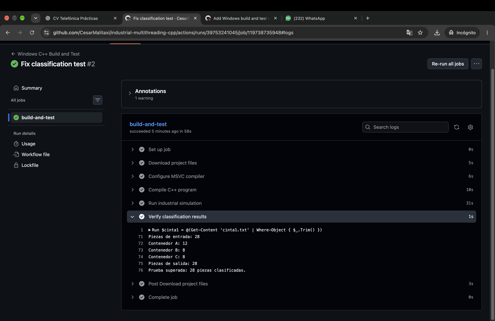

# Industrial Sorting System — C++ Multithreading

**Academic Engineering Project | Universidad Europea de Madrid | 2026**

## Overview

Development of an industrial sorting simulation using C++ and the Windows Win32 API.

The application simulates two conveyor belts supplying parts to two robotic sorting stations. Five concurrent threads coordinate production, classification and system monitoring.

The project demonstrates concurrent programming, synchronization of shared resources and automated software testing.

## Technologies

- C++ and Windows Win32 API
- Multithreading using `CreateThread`
- Mutexes and semaphores
- Shared circular buffer with 8 positions
- File input/output
- Production monitoring
- GitHub Actions for automated Windows testing

## System Architecture

The application uses five concurrent threads:

- **2 producer threads:** simulate conveyor belts supplying parts.
- **2 consumer threads:** simulate robots inspecting and classifying parts.
- **1 monitoring thread:** displays production statistics every five seconds.

Mutexes protect shared data, while semaphores coordinate the availability of pieces and free buffer positions.

Parts are classified into three categories: A, B and C.

## How to Run

**Requirements:** Windows and Microsoft Visual C++ compiler (MSVC).

1. Download the repository.
2. Open the project directory using a Visual Studio Developer Command Prompt.
3. Compile the application:

`cl /nologo /EHsc /std:c++17 /Fe:industrial_sorting.exe industrial_sorting.cpp`

4. Execute:

`industrial_sorting.exe`

The program reads `cinta1.txt` and `cinta2.txt` and generates `ContA.txt`, `ContB.txt` and `ContC.txt`.

## Test Results

The project was compiled and executed successfully on Windows using GitHub Actions.

| Metric | Result |
|---|---|
| Input parts | 28 |
| Processed parts | 28 |
| Type A | 12 |
| Type B | 8 |
| Type C | 8 |
| Compilation | Successful |
| Automated test | Passed |

The automated test verifies compilation, execution and matching input/output record counts.

### Automated Test Evidence

## Limitations

This project is a software simulation. No physical conveyor belts or industrial robots were connected.

The current automated test checks record counts but does not exhaustively validate every possible concurrent execution scenario.

## Project Team

- César Malitaxi Martínez
- Ignacio Barreiro San Martín
- Luka Franjo Kurtovic Shiguiyama

**Course:** Industrial Computing — Universidad Europea de Madrid.

Developed collaboratively as an academic engineering project.
